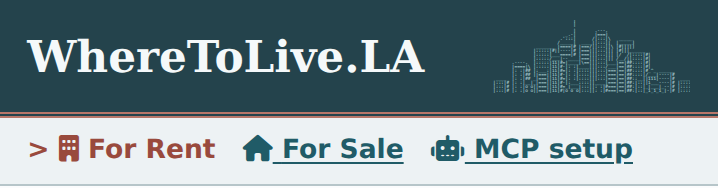
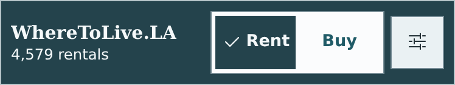

# [WhereToLive.LA](https://wheretolive.la)

```text
                               |
                               |
                               |       .---.
                            _.-|       [===]
                          .':::|      /|:::|\   _____
                         /_____|  ____||:::||  |_____]
                 _______ |====|# |===/||:::||\ |#||||]
                |:::::|#||----|# |===|||:::||| |#|||______
                |:::::|___====|# |===|||:::||| |/  /|::::|#|
                |:::::/___|--____|===|||:::||| /__/||::::|#|
        .----.  |:::::|ii|#=|____|\==|||:::|___|==|##::::|#|
        |====|\ |:::::|ii|#-|: :|____|||:::/___|==|##::::|#|
        |: :|## |:___:|ii|#=|: :|::::|||:::|===|==|##::::|#_^_ ______
        |: :|## ||===||ii|#-|: :|::::|||:::|===|==|##::::|/___|----|#
  ____  |: :|## _|===||ii|#=|: :|::::|||:::|===|==|##::__||iii|----|#  ____
 |:::|# |: :|__|_|===||ii|#-|:___::::||____|===|==|##:|::||i___----|# |::::
 |:::|# |: :|o o||===||ii|#=_|___|:::||: :|#===|==|##:|::|_|___|_--|# |::::
 |:::|# |: :|o o||===||ii|#|o o o|:::||: :|#===|==|##:|::|_i_i_i_|-|# |::::
===========================================================================

    __      ___                  _____      _    _           _      _
    \ \    / / |_  ___ _ _ ___  |_   _|__  | |  (_)_ _____  | |    /_\
     \ \/\/ /| ' \/ -_) '_/ -_)   | |/ _ \ | |__| \ V / -_)_| |__ / _ \
      \_/\_/ |_||_\___|_| \___|   |_|\___/ |____|_|\_/\___(_)____/_/ \_\
```

## Table of contents

- [MCP server](#mcp-server)
- [What I'm Using](#what-im-using)
- [A Deeper Dive](#a-deeper-dive)
- [How to Build and Run](#how-to-build-and-run)
  - [Docker](#docker)
  - [Non-Docker](#non-docker)

[](https://github.com/perfectly-preserved-pie/larentals/actions/workflows/codeql-analysis.yml)

[](https://github.com/perfectly-preserved-pie/larentals/actions/workflows/docker-image.yml)

[](https://github.com/perfectly-preserved-pie/larentals/actions/workflows/docker-image-dev.yml)

This is an interactive map based on /u/WilliamMcCarty's and /u/TannerBeyer's weekly spreadsheets of new rental & for-sale listings in the /r/LArentals & /r/LosAngelesRealEstate subreddits. Just like the actual spreadsheets, you can filter the map based on different criteria, such as
* Monthly rent/List price
* Security deposit cost
* Number of bedrooms
* Number of garage spaces
* Pet Policy
* Square footage
* HOA fees (for-sale properties only)
* and more!

Some additional capabilities are offered, such as a featured MLS photo for the property and a link to the associated MLS listing page (if available).

On desktop, use **For Rent** and **For Sale** in the sidebar to switch maps.



On phones, use **Rent** and **Buy** in the map toolbar.



[Open the rental map](https://wheretolive.la/) or [open the for-sale map](https://wheretolive.la/buy).


**⚠ This website is mobile-friendly but I highly recommend using an actual computer or tablet for the best experience**

### MCP server

See the [MCP setup guide](https://wheretolive.la/mcp) for copyable Claude,
Hermes, and generic client instructions.

The endpoint supports the stateless MCP `2026-07-28` protocol and retains
Dash's initialization-based `2025-11-25` transport for legacy clients.


## What I'm Using
* [BeautifulSoup](https://www.crummy.com/software/BeautifulSoup/bs4/doc/) (webscraping MLS photos and links)
*    [Dash Leaflet](https://dash-leaflet.herokuapp.com/) (displaying the map and graphing the markers)
*    [Dash Bootstrap Components](https://dash-bootstrap-components.opensource.faculty.ai/) (the website layout and icons)
*    [GeoPy](https://geopy.readthedocs.io/en/stable/) (geocoding coordinates via the Google Maps API)
*    [ImageKit](https://github.com/imagekit-developer/imagekit-python) (resizing MLS photos into a standard size on the fly)
*    [Pandas](https://pandas.pydata.org/) (handling and manipulating the rental property data for each address)

## A Deeper Dive
[I made a post detailing my idea, progress, challenges, etc.](hhttps://automateordie.dev/wheretolivedotla/)

## How to Build and Run

Clone the repository and run the commands below from the project directory.

```bash
git clone https://github.com/perfectly-preserved-pie/larentals.git
cd larentals
```

### Docker

With Docker running, build the app image.

```bash
docker build -t larentals .
```

Start the container.

```bash
docker run --rm -p 8080:8080 larentals
```

Open [http://localhost:8080](http://localhost:8080).

### Non-Docker

With `uv` installed, start the Dash development server. The project uses Python
3.13, and `uv` installs the project and its dependencies into `.venv`.

```bash
uv run wheretolive-la
```

Open [http://127.0.0.1:8050](http://127.0.0.1:8050).
