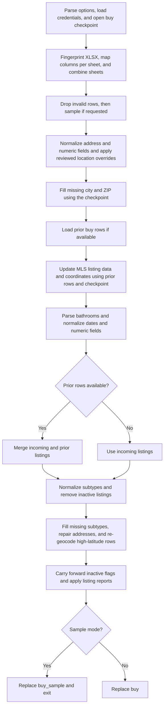
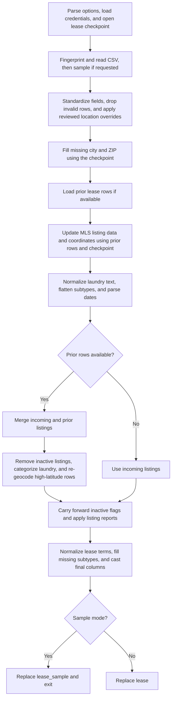

# Weekly listing refresh

## EC2 refresh script

The [EC2 refresh script](../scripts/aws_ec2_user_data_script.sh) starts the
buy and lease jobs in parallel. Each job has a separate staging database and
lookup checkpoint. The sample and full runs for that market share both.

```mermaid
flowchart TD
    Start["Install exit trap and system packages"] --> Checkout{"Repository exists?"}
    Checkout -->|Yes| Pull["Pull with --ff-only"]
    Checkout -->|No| Clone["Clone repository"]
    Pull --> Setup["Install uv, sync locked dependencies, and resolve artifact paths"]
    Clone --> Setup
    Setup --> Seed{"Current SQLite database exists?"}
    Seed -->|Yes| Copy["Copy database into both staging paths"]
    Seed -->|No| Launch["Start both jobs in parallel"]
    Copy --> Launch
    Launch --> LeaseSample["lease-dataframe --sample 15"]
    Launch --> BuySample["buy-dataframe --sample 15"]
    LeaseSample -->|Success| LeaseFull["lease-dataframe (full)"]
    BuySample -->|Success| BuyFull["buy-dataframe (full)"]
    LeaseSample -->|Failure| Wait["Wait for lease PID, then buy PID"]
    BuySample -->|Failure| Wait
    LeaseFull --> Wait
    BuyFull --> Wait
    Wait --> Status{"Both jobs succeeded?"}
    Status -->|No| Error["Exit with failure"]
    Status -->|Yes| Publish["publish-listing-tables: replace both local tables in one transaction"]
    Publish --> Schools["enrich-schools"]
    Schools --> Fetch["fetch-cpuc-broadband-geopackage"]
    Fetch --> Merge["run-broadband-merge"]
    Merge --> ALPR["fetch-alpr-cameras"]
    ALPR --> Validate["Check database file, SQLite integrity, and nonempty buy and lease tables"]
    Validate --> Reconcile["reconcile-imagekit-assets --apply"]
    Reconcile --> Result{"Reconcile exit status?"}
    Result -->|0| Audit["Upload ImageKit audit files to S3"]
    Result -->|3| Warn["Log warning and defer ImageKit cleanup"]
    Result -->|Other| Error
    Warn --> Audit
    Audit --> Upload["Upload SQLite database to S3"]
    Upload --> Verify{"S3 object size matches local file?"}
    Verify -->|No| Error
    Verify -->|Yes| Shutdown["Exit trap logs status and requests instance shutdown"]
    Error --> Shutdown
```

The script clears old staging files before checking for a database to copy.
The two sample runs each select 15 rows and write to `lease_sample` or
`buy_sample`. The shell starts a market's full run only after that market's
sample succeeds. It waits for both jobs before deciding whether to publish.
The transaction updates the local database. S3 gets the database after
enrichment, validation, and ImageKit audit upload. An unhandled command
failure also reaches the exit trap.

## Buy builder

[Source for `buy-dataframe`](buy_dataframe.py). This builder checks for
inactive listings and re-geocodes high-latitude rows even when there are no
prior listings to merge.

## Lease builder

[Source for `lease-dataframe`](lease_dataframe.py). The lease builder samples
the CSV before cleanup. Its inactive-listing check and high-latitude
geocoding run inside the branch that merges prior listings.

Both builders narrow prior listings to the sampled MLS numbers during sample
runs. See the [broadband workflow](qgis_cpuc_broadband_to_gpkg.md#automated-workflow)
for the GeoPackage reuse decision and
[Listing Enrichment Rollout](listing_enrichment_rollout.md#current-hook-points)
for how the maps load the resulting enrichment fields.
